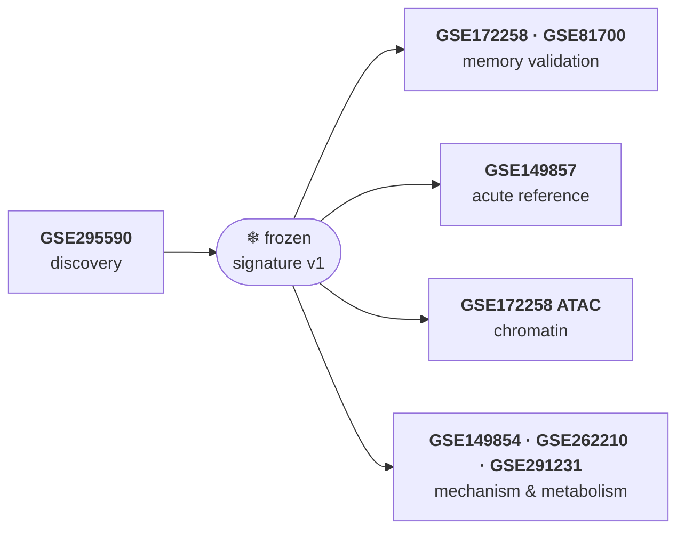
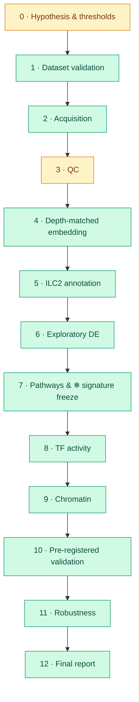

<div align="center">

# Lung ILC2 Trained-Immunity Signatures

**A reproducible, replicate-aware reanalysis of recall-associated transcriptional programs in mouse lung ILC2s**


-8A2BE2)


[Findings](#-findings) ·
[Question](#-scientific-question) ·
[Datasets](#-datasets) ·
[Pipeline](#-pipeline) ·
[Quickstart](#-quickstart) ·
[Principles](#-principles) ·
[Team](#-team)

**→ Full results: [`reports/FINAL_REPORT.md`](reports/FINAL_REPORT.md)** (generated from `results/`, no hand-typed numbers)

</div>

---

## 🔎 Findings

| | Result | Evidence level |
|---|---|---|
| 🟢 | Secondary-response lung ILC2s carry a **reproducible metabolic–proliferative recall program** — OXPHOS, glycolysis, MYC and mTORC1 up; NF-κB/TNFα, JAK-STAT and AP-1 activity down. Two contrasts that share no primary cells agree genome-wide (r ≈ 0.9). | **A** · exploratory |
| 🟢 | The source study's reported genes **Arg1, Cox5a, Pkm** are reproduced; **Csf2** is strongly *down* (reported unchanged). | A |
| 🟢 | A **100-gene signature was frozen** (SHA-256 in `signatures/MANIFEST.tsv`) before any validation data were analysed; 97/100 genes survive ≥ 80 % of sensitivity scenarios, including the source study's own QC. | A |
| 🟡 | The program is **not influenza-type activation** (no signature gene tracks it; Calca, Csf2, Plaur move *opposite*) but **closely mirrors IL-33-driven activation**: all 48 measurable up-genes rise 4 days after IL-33, the match weakens by week 2 and is gone at 4 months. | A |
| 🟡 | **Chromatin support in wild-type allergen-memory ILC2s** (signature genes open, p ≈ 10⁻⁹) but not in Rag1⁻/⁻ — *partial regulatory support* under the pre-registered rule. | partial **B** |
| 🔴 | **Not reproduced in long-lived memory**: GSE172258 one week after recall and GSE81700 at 4 months — pre-registered verdict *Not supported*. | — |
| 💡 | **Interpretation:** secondary ILC2s show an *intensified type-2 activation / recall state*, not a persistent resting memory program. | — |
| ⚠️ | The published analysis appears to use **only one of two primary libraries** (189 published vs 197 ILC2s in S2 at the paper's QC); the other (S1) is 5.6× shallower and carries ambient/stress signal. | data audit |

**Not claimed:** classical trained immunity or causal epigenetic memory (level C). One secondary library and an
unknown mouse-to-library mapping make all inference exploratory — see *Limitations* in the final report.

---

## 🧬 Scientific question

> **What distinguishes a trained/persistent ILC2 state from an acutely activated ILC2 state — and
> which transcriptional, metabolic and regulatory programs are associated with that state?**

Group 2 innate lymphoid cells (ILC2s) lack antigen-specific receptors, yet previously activated lung ILC2s
can respond differently to later challenges. We start from one discovery dataset, **freeze** a candidate
signature, and test it against independent memory-like, acute-inflammatory, regulatory and metabolic
datasets under **rules written down before the validation data were opened**.

| | Claim | Within reach? |
|---|---|---|
| **A** | A *trained/recall-associated* ILC2 transcriptional state | ✅ reached |
| **B** | Regulatory or chromatin support for that state | 🟡 partial (wild-type only) |
| **C** | Classical trained immunity or causal epigenetic memory | ❌ needs functional, longitudinal evidence |

---

## 📚 Datasets

| Dataset | Role | Model · assay | Outcome |
|---|---|---|---|
| 🔴 **GSE295590** | **Discovery** | *N. brasiliensis* primary vs secondary (day 3) · 10x scRNA-seq | signature v1 |
| 🔴 **GSE172258** | Memory validation + chromatin | Repeated *Alternaria* · 20/40-cell mini-bulk RNA + ATAC-seq | RNA: not supported · ATAC: partial |
| 🔴 **GSE149857** | Acute reference | Influenza day 5 / 10 · scRNA-seq | not acute-shared |
| 🟠 GSE81700 | Memory-like validation | IL-33, naive → 4 months · microarray | day 4 / week 2 partial · 4 months not supported |
| 🟠 GSE149854 | BATF context | Influenza, WT vs *Batf* KO · bulk RNA-seq | not BATF-dependent |
| 🟡 GSE262210 | Metabolic context | Iron deprivation · bulk RNA-seq | up-genes iron-responsive |
| 🟡 GSE291231 | Blimp-1 / stimulation context | bulk RNA-seq | enriched in Blimp-1 KO |
| ⚪ GSE291230 | Blimp-1 ATAC | bigwig tracks only | not integrated |



Roles and caveats → [`docs/datasets.md`](docs/datasets.md) · validation rules → [`docs/validation_plan.md`](docs/validation_plan.md)

---

## 🔬 Pipeline

Thirteen phases, each closed by a **gate**. Every phase writes a Markdown report to `reports/phaseN/`.



Phases 0 and 3 are complete with **provisional thresholds** awaiting collaborator review (D-010).
Phase table, gates and script map → [`docs/pipeline.md`](docs/pipeline.md)

---

## 🚀 Quickstart

**Requirements:** Python ≥ 3.10 and Conda/Mamba. ~8 GB RAM; the full pipeline runs in ~25 min on a laptop.

```bash
git clone <repo-url> ilc2-trained-immunity && cd ilc2-trained-immunity
conda env create -f environment.yml && conda activate ilc2-tri

make fetch            # GSE295590 matrices          (~120 MB)
make fetch-all        # validation datasets          (~6 GB, resumable)
make fetch-resources  # MSigDB, CollecTRI, PROGENy, mm10 TSS, GPL16570
make all              # Phases 1–12 → reports/FINAL_REPORT.md
make test             # 40 tests
make help             # every command
```

<details>
<summary><b>Script reference</b></summary>

| Script | Phase | Make target | Report |
|---|---|---|---|
| `00_fetch_gse295590.sh`, `fetch_geo.py`, `fetch_resources.py` | 2 | `fetch`, `fetch-all`, `fetch-resources` | download manifests with SHA-256 |
| `01_validate_sample_metadata.py` | 1 | `validate` | `reports/validation/` |
| `02_validate_geo_sra_crosswalk.py` | 1 | `validate` | `reports/validation/` |
| `03_qc.py` | 3 | `qc` | `reports/qc/` |
| `04_embed.py` | 4 | `embed` | `reports/phase4/` |
| `05_annotate.py` | 5 | `annotate` | `reports/phase5/` |
| `06_de.py` | 6 | `de` | `reports/phase6/` |
| `07_pathways.py` | 7 | `pathways` | `reports/phase7/` + `signatures/` |
| `08_tf_activity.py` | 8 | `tf` | `reports/phase8/` |
| `09_chromatin.py` | 9 | `chromatin` | `reports/phase9/` |
| `10_validate.py` | 10 | `validate-external` | `reports/phase10/` |
| `11_robustness.py` | 11 | `robustness` | `reports/phase11/` |
| `12_final_report.py` | 12 | `report` | `reports/FINAL_REPORT.md` |

All Python scripts: `--help`; exit codes `0` pass · `1` gate/validation fail · `2` missing input.
</details>

<details>
<summary><b>Working in VS Code</b></summary>

Open the folder, accept the recommended extensions (Python, Ruff, Jupyter, Rainbow CSV, Mermaid preview),
select the `ilc2-tri` interpreter, then **Terminal → Run Task…** for validations, QC and tests. The Testing
panel discovers `tests/` automatically; Ruff formats on save.
</details>

<details>
<summary><b>Changing a threshold</b></summary>

Edit `config/parameters.yaml`, add an entry to `docs/decision_log.md`, then `make all`. The frozen
signature is never overwritten: if Phase 7 would produce a different gene list it stops and asks for a new
version number, so validation results always refer to a known, hashed signature.
</details>

---

## 🗂 Repository layout

```
ilc2-trained-immunity/
├── config/        datasets.yaml · parameters.yaml · markers.yaml
├── metadata/      curated GSE295590 sample & SRA tables
├── docs/          hypotheses · datasets · design · pipeline · validation plan · decision log
├── signatures/    frozen, hashed discovery signatures
├── src/ilc2tri/   library code — one module per phase
├── scripts/       thin numbered entry points (00–12)
├── tests/         pytest suite (40 tests)
├── reports/       per-phase reports + FINAL_REPORT.md   ← committed evidence
├── references/    downloaded resources (manifest committed)
├── data/          raw downloads (git-ignored, re-creatable)
└── results/       analysis outputs (git-ignored, re-creatable)
```

---

## 🧭 Principles

1. **The animal is the unit, not the cell.** With one secondary library, p-values rank genes; agreement between independent contrasts and datasets is the evidence.
2. **Unknown stays unknown.** No mouse, pooling or replicate assignment is inferred without a source.
3. **Rules before results.** Resolution, signature and validation rules were fixed before the data they judge; deviations are logged.
4. **Freeze, then validate.** The signature is hashed and committed before validation data are opened.
5. **Every claim carries its evidence level** (A / B / C), and negative results are reported as prominently as positive ones.
6. **Reproducible by construction** — environment file, fixed seeds, checksummed downloads, config-driven parameters, generated reports.
7. **Decisions are written down** in [`docs/decision_log.md`](docs/decision_log.md).

---

## 🤝 Team

| | Role |
|---|---|
| **Alperen Göçmen** · Molecular Biology & Genetics, Uşak Üniversitesi | Computational pipeline, analyses, technical validation |
| **Divya** | Study design review, dataset curation, biological interpretation |

How we work together → [`CONTRIBUTING.md`](CONTRIBUTING.md) · history → [`CHANGELOG.md`](CHANGELOG.md) ·
open question to the GSE295590 authors → [`docs/author_query.md`](docs/author_query.md)

## 📄 Citation & license

Discovery data: GSE295590 ([PMC13382995](https://pmc.ncbi.nlm.nih.gov/articles/PMC13382995/)). Please cite
the original study for every dataset used, and MSigDB, CollecTRI, PROGENy, decoupler, Scanpy and PyDESeq2 for
the methods. A license will be chosen by both collaborators before the repository is made public.
