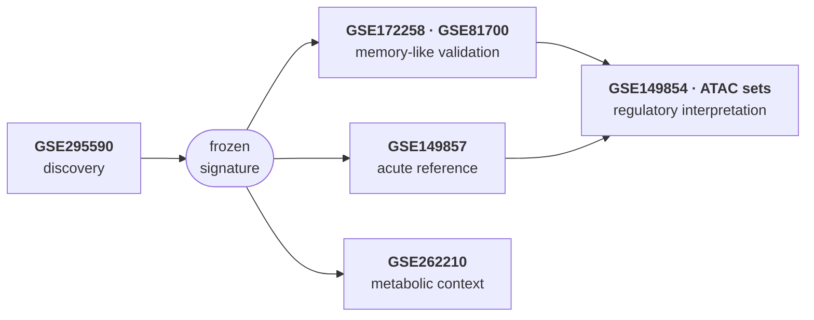
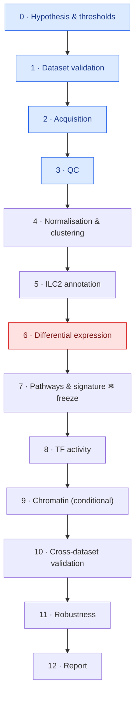

<div align="center">

# Lung ILC2 Trained-Immunity Signatures

**A reproducible, replicate-aware reanalysis of trained/recall-associated transcriptional programs in mouse lung ILC2s**


[Question](#-scientific-question) ·
[Datasets](#-datasets) ·
[Pipeline](#-pipeline) ·
[Status](#-current-status) ·
[Quickstart](#-quickstart) ·
[Principles](#-principles) ·
[Team](#-team)

</div>

---

## 🧬 Scientific question

> **What distinguishes a trained/persistent ILC2 state from an acutely activated ILC2 state — and
> which transcriptional, metabolic and regulatory programs are associated with that state?**

Group 2 innate lymphoid cells (ILC2s) lack antigen-specific receptors, yet previously activated
lung ILC2s can respond differently to later challenges. This project asks which molecular programs
accompany that altered response, and how far public data can take that claim.

We start from a single discovery dataset, **freeze** a candidate signature, and then test it
against independent memory-like, acute-inflammatory, regulatory and metabolic datasets.

### What this project will — and will not — claim

| | Claim | Within reach? |
|---|---|---|
| **A** | A *trained/recall-associated* ILC2 transcriptional state, reproducible across datasets | ✅ Primary goal |
| **B** | Regulatory or chromatin support for that state | ✅ Where compatible data exist |
| **C** | Classical trained immunity or causal epigenetic memory | ❌ Requires functional, longitudinal evidence |

A transcriptional signature alone does not prove trained immunity, cellular memory or causality.
Every result in this repository is labelled with the rung of evidence it reaches.

---

## 📚 Datasets

| Dataset | Role | Model · assay |
|---|---|---|
| 🔴 **GSE295590** | **Discovery** | *N. brasiliensis* primary vs secondary infection · scRNA-seq |
| 🔴 **GSE172258** | Independent memory validation | Repeated *Alternaria* exposure · scRNA-seq + ATAC-seq |
| 🔴 **GSE149857** | Acute inflammatory reference | Influenza · scRNA-seq |
| 🟠 GSE81700 | Memory-like validation (signature level) | IL-33-activated, long-lived ILC2 · microarray |
| 🟠 GSE149854 | BATF regulatory context | Influenza, WT vs *Batf* KO · bulk RNA-seq |
| 🟡 GSE262210 | Metabolic context | Iron availability and ILC2 metabolism |
| 🟡 GSE291230 / 291231 | Regulatory reference | IL-9 / Blimp-1 · ATAC-seq + RNA-seq |



Roles, caveats and compatibility rules → [`docs/datasets.md`](docs/datasets.md) ·
machine-readable registry → [`config/datasets.yaml`](config/datasets.yaml)

---

## 🔬 Pipeline

Thirteen phases, each closed by a **gate**: the next phase does not start until its condition holds.



Full phase table with outputs and gates → [`docs/pipeline.md`](docs/pipeline.md)

---

## 📍 Current status

**GSE295590 accession structure validated · replicate mapping open · Phase 3 QC script ready for the first real-data run.**

| | |
|---|---|
| ✅ | Study design reconstructed: 20 WT mice (10 primary + 10 secondary), FACS Live CD45⁺ Lin⁻ CD90.2⁺ CD127⁺, 10x 3′ scRNA-seq |
| ✅ | Accession crosswalk validated: 3 GEO samples → 3 BioSamples → 3 SRA Experiments → 6 SRR runs |
| ❓ | **Mouse-to-library mapping and pre-library pooling unresolved** — query to authors drafted ([`docs/author_query.md`](docs/author_query.md)) |
| ⏸ | Formal differential expression blocked until replicate structure is known ([D-004](docs/decision_log.md)) |
| ✅ | Data downloaded and checksummed; cell counts reproduced exactly (9,012 / 838 / 8,677) |
| 🔄 | Phase 3 QC run: matrices pre-filtered at ≈ 500 UMI, **S1 sequenced ~5.6× shallower**, ~10 % damaged cells in S3, scrublet auto-threshold failed. Thresholds proposed, awaiting review → [`docs/qc_threshold_proposal.md`](docs/qc_threshold_proposal.md) |

Details → [`docs/GSE295590_design.md`](docs/GSE295590_design.md)

---

## 🚀 Quickstart

**Requirements:** Python ≥ 3.10. Conda/Mamba for the full analysis environment.
The Phase 1 validators use only the standard library; QC and later phases need the conda environment.

```bash
git clone <repo-url> ilc2-trained-immunity
cd ilc2-trained-immunity

# Full analysis environment (Scanpy, decoupler, gseapy, …)
conda env create -f environment.yml
conda activate ilc2-tri

# — or — lightweight, validators + tests only
python -m pip install -e ".[dev]"

make test        # 26 tests
make validate    # Scripts 01 + 02 → reports/validation/
make fetch       # Phase 2: download GSE295590 matrices into data/raw/
make qc          # Phase 3: QC report → reports/qc/, outputs → results/qc/
make help        # all commands
```

<details>
<summary><b>Example output</b></summary>

```text
$ make validate
STRUCTURAL METADATA VALIDATION: PASS — report saved to reports/validation/01_sample_metadata.md
GEO-SRA CROSSWALK VALIDATION: PASS — report saved to reports/validation/02_geo_sra_crosswalk.md
```

A passing status covers accession structure only. Every report ends with the same safeguards:

```text
- Mouse-to-library mapping: UNKNOWN / not established.
- Pre-library pooling status: UNKNOWN / not established.
- Independent biological replicate structure: UNKNOWN / not inferred.
```
</details>

<details>
<summary><b>Working in VS Code</b></summary>

Open the folder and accept the recommended extensions (Python, Ruff, Jupyter, Rainbow CSV,
Mermaid preview). Then:

- **Terminal → Run Task…** → `ILC2: run all validations` or `ILC2: run tests`
- Testing panel discovers `tests/` automatically
- Ruff formats on save; select the `ilc2-tri` interpreter (`Ctrl/Cmd + Shift + P` → *Python: Select Interpreter*)
</details>

<details>
<summary><b>Script reference</b></summary>

| Script | Phase | Input | Status label |
|---|---|---|---|
| `scripts/00_fetch_gse295590.sh` | 2 | — | download log with SHA-256 |
| `scripts/01_validate_sample_metadata.py` | 1 | `metadata/GSE295590/samples.tsv` | `STRUCTURAL METADATA VALIDATION` |
| `scripts/02_validate_geo_sra_crosswalk.py` | 1 | `metadata/GSE295590/sra_crosswalk.tsv` | `GEO-SRA CROSSWALK VALIDATION` |
| `scripts/03_qc.py` | 3 | `data/raw/GSE295590/` | `PHASE 3 GATE` (NOT EVALUABLE until thresholds agreed) |

All Python scripts: `--help`, Markdown report via `--report PATH` (stdout otherwise),
exit codes `0` pass · `1` validation fail · `2` I/O error.
</details>

---

## 🗂 Repository layout

```
ilc2-trained-immunity/
├── config/                  datasets.yaml · parameters.yaml (thresholds: null until agreed)
├── metadata/GSE295590/      samples.tsv · sra_crosswalk.tsv   ← curated, committed
├── docs/                    hypothesis · datasets · design note · pipeline · decision log
├── src/ilc2tri/             library code (readers, validators, reference accessions)
├── scripts/                 NN_name.py — thin, numbered entry points per phase
├── tests/                   pytest suite
├── notebooks/               exploration only — results come from scripts
├── data/{raw,processed}/    git-ignored, re-creatable from accessions
├── results/                 git-ignored analysis outputs, one folder per phase
└── reports/                validation/ + qc/ — committed, reviewable evidence
```

---

## 🧭 Principles

1. **The animal is the unit, not the cell.** Thousands of cells from one library are one observation.
2. **Unknown stays unknown.** No mouse, pooling or replicate assignment is inferred without a source.
3. **Thresholds are agreed before results are seen** — `null` in config blocks the gated step.
4. **Freeze, then validate.** The discovery signature is committed before validation data is opened.
5. **Every claim carries its evidence level** (A / B / C).
6. **Reproducible by construction** — pinned environment, fixed seeds, logged downloads with
   checksums, config-driven parameters, versioned scripts.
7. **Decisions are written down** in [`docs/decision_log.md`](docs/decision_log.md).

---

## 🤝 Team

| | Role |
|---|---|
| **Alperen Göçmen** · Molecular Biology & Genetics, Uşak Üniversitesi | Computational pipeline, QC and expression analyses, technical validation |
| **Divya** | Study design review, dataset curation, biological interpretation |

How we work together → [`CONTRIBUTING.md`](CONTRIBUTING.md) · history → [`CHANGELOG.md`](CHANGELOG.md)

## 📄 Citation & license

Discovery data: GSE295590 and its publication
([PMC13382995](https://pmc.ncbi.nlm.nih.gov/articles/PMC13382995/)). Please cite the original
studies for every dataset used. A license will be chosen by both collaborators before this
repository is made public.
