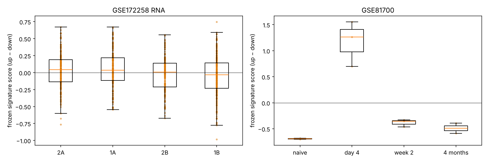

# Phase 10 — cross-dataset validation of the frozen signature

Pre-registered rules: [`docs/validation_plan.md`](../../docs/validation_plan.md) (D-014). Signature: `GSE295590_recall_ILC2_signature_v1.tsv`.

## Overall: **Partially supported**

## Core memory / recall datasets
| dataset | comparison | units (test v ref) | Δ score | score p | gene agreement | up / down | gene p | verdict |
|---|---|---|---|---|---|---|---|---|
| GSE172258 RNA | after recall: Alt-sensitised (1B) vs saline (2B) | 279 v 202 | -0.0287 | 0.872 | 36/80 (0.45) | 22/39 / 14/41 | 0.843 | **Not supported** |
| GSE172258 RNA | before recall: Alt-sensitised (1A) vs saline (2A) | 235 v 213 | 0.0166 | 0.312 | 44/80 (0.55) | 16/39 / 28/41 | 0.217 | **Not supported** |
| GSE81700 | lung ILC2 4 months after IL-33 vs naive | 2 v 2 | 0.203 | n/a | 46/93 (0.495) | 20/48 / 26/45 | 0.582 | **Not supported** |
| GSE81700 | lung ILC2 week 2 after IL-33 vs naive | 3 v 2 | 0.311 | n/a | 55/93 (0.591) | 38/48 / 17/45 | 0.0483 | **Partially supported** |
| GSE81700 | lung ILC2 day 4 after IL-33 vs naive | 3 v 2 | 1.86 | n/a | 69/93 (0.742) | 48/48 / 21/45 | 1.65e-06 | **Partially supported** |

Notes: GSE172258 RNA — Δscore 20-cell wells -0.01, 40-cell wells -0.06; 929 wells ≥ 1000 UMI; GSE172258 RNA — Δscore 20-cell wells 0.04, 40-cell wells 0.00; 929 wells ≥ 1000 UMI; GSE81700 — 16 arrays; lung only; GSE81700 — 16 arrays; lung only; GSE81700 — 16 arrays; lung only

## Acute-activation reference — GSE149857 (influenza, lung ILC2s)
ILC2s analysed: day 5 179, day 10 395. Signature genes correlated with an acute activation axis (without signature genes) in the signature's direction on both days: **0** (recall_up 0/44, recall_down 0/44 measurable).

- **Acute-shared:** none
- **Recall-specific candidates (measurable, not acute-shared):** AW112010, Alad, Aprt, Arg1, B930036N10Rik, Batf, Bloc1s1, Calca, Camk2n1, Cd74, Cebpb, Cisd1, Cox5a, Csf2, Cst7, Cxcr4, Dctpp1, Dut, Ecm1, Ets2, Fcer1g, Fos, Gapdh, Gem, Glrx, Gm11808, H2-Aa, H2-Ab1, H2-DMa, H2-Q4, Hes1, Hint1, Ifi203, Il13, Impa2, Isg15, Kit, Klf10, Klf3, Klf4, Kmt2d, Lgals1, Lpcat2, Malat1, Mrpl12, Mrpl51, Nhp2, Nme1, Npm1, Nudcd2, Nudt21, Pdcd4, Plaur, Prdx4, Rab27b, Rasgrp2, Rnaset2a, Rnaset2b, Sdc4, Serpinb6a, Serpinb9, Sh3bgrl, Siva1, Snhg9, Socs2, Spry2, Susd6, Tle4, Tnfrsf4, Tnfrsf9, Tomm5, Tpi1, Trim12a, Uba52, Vim, Zfp36

- **Opposite to acute activation** (signature direction opposite to the acute correlation, FDR < 0.05 on both days; these separate recall from acute activation most clearly): Calca, Csf2, Plaur

## Mechanistic and context datasets
| dataset | question | in signature | background | odds ratio | p | note |
|---|---|---|---|---|---|---|
| GSE149854 | recall_up genes reduced in Batf KO (BATF-dependent) | 3/31 | 3752/6369 | 0.0747 | 1 | authors' DESeq2 table (appears pre-filtered); log2FC orientation inferred from FPKM means: WT/KO |
| GSE262210 | recall_up genes changed by iron deprivation (DEF vs vehicle) | 47/50 | 9078/13532 | 7.69 | 5.83e-06 | DESeq2, 3 v 3 |
| GSE262210 | recall_down genes changed by iron deprivation (DEF vs vehicle) | 32/46 | 9093/13536 | 1.12 | 0.433 | DESeq2, 3 v 3 |
| GSE291231 | signature direction under in-vitro stimulation (activation-shared?) | 59/95 agree | - | nan | 0.0117 | DESeq2 paired by mouse, 4 v 4 |
| GSE291231 | signature genes changed in Blimp-1 KO | 24/98 | 1076/16277 | 4.58 | 2.09e-08 | DESeq2, 3 v 3 |

## Figures

