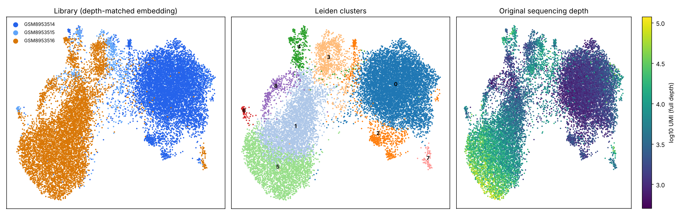

# Phase 4 — normalisation, embedding and clustering · GSE295590

- Cells: **17,575** (after provisional Phase 3 filtering, D-010)
- **PHASE 4 GATE: PASS** — clustering stable across 5 seeds (min ARI ≥ 0.8: True); depth no longer drives PC1 (|r| < 0.3: True).

## Depth handling
- Median UMI per cell (full depth): `GSM8953514` 1,283, `GSM8953515` 7,366, `GSM8953516` 8,451
- Binomial thinning factors to the shallowest library: `GSM8953514` × 1.000, `GSM8953515` × 0.174, `GSM8953516` × 0.152
- |r| between PC1 and log depth: **0.77** on full-depth data → **0.17** on depth-matched data.
- Full-depth counts are retained (`layers['counts']`) for differential expression.

## Batch evaluation (no correction applied — D-011)
The secondary condition has a single library, so library and condition are fully confounded; any cross-library correction would remove the biology under study. Composition per cluster:

| cluster | GSM8953514 | GSM8953515 | GSM8953516 |
|---|---|---|---|
| 0 | 8,175 | 109 | 42 |
| 1 | 52 | 97 | 4,040 |
| 2 | 630 | 65 | 14 |
| 3 | 59 | 355 | 498 |
| 4 | 59 | 84 | 248 |
| 5 | 18 | 15 | 2,540 |
| 6 | 4 | 29 | 31 |
| 7 | 12 | 3 | 64 |
| 8 | 2 | 54 | 276 |

## Resolution selection (pre-specified rule)
Highest resolution whose minimum ARI across 5 Leiden seeds is ≥ 0.8 → **0.5** (9 clusters).

| resolution | clusters | min ARI | mean ARI |
|---|---|---|---|
| 0.2 | 5 | 0.985 | 0.990 |
| 0.3 | 7 | 0.979 | 0.986 |
| 0.4 | 8 | 0.958 | 0.963 |
| 0.5 | 9 | 0.816 | 0.882 |
| 0.6 | 9 | 0.740 | 0.821 |
| 0.8 | 12 | 0.623 | 0.652 |
| 1.0 | 14 | 0.671 | 0.708 |
| 1.2 | 16 | 0.496 | 0.603 |

## Figures

