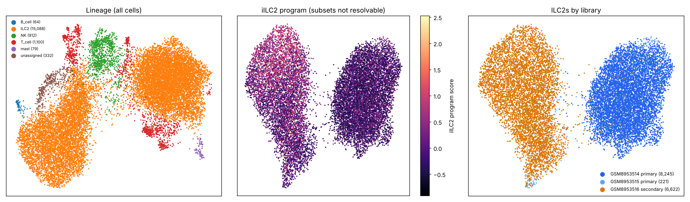
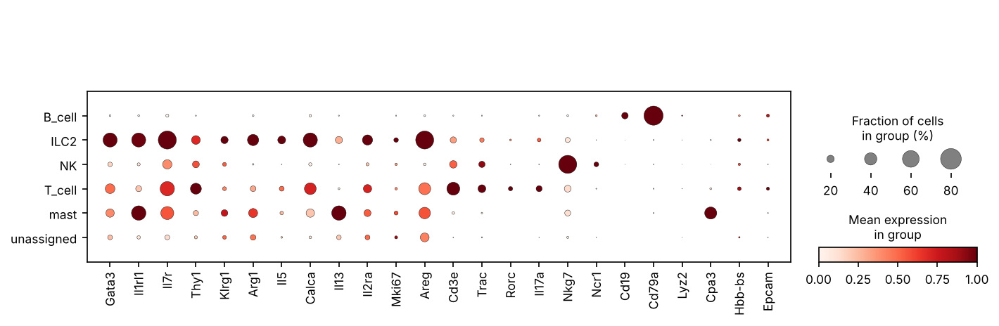

# Phase 5 — ILC2 identification and subset annotation · GSE295590

- **PHASE 5 GATE: PASS** — ILC2 confirmed by ILC2-identity *and* type-2 effector categories; ≥ 100 ILC2 cells required per library.
- Marker genes not present in the data: none

## Lineage per cluster (mean category scores; label = highest raw score)
| cluster | ILC2 | T_cell | type3_gdT | NK | B_cell | myeloid_DC | mast | erythroid | epithelial | label | second | second_to_best | mixed_flag | n_cells |
|---|---|---|---|---|---|---|---|---|---|---|---|---|---|---|
| 0 | 0.30 | 0.17 | 0.03 | -0.03 | 0.00 | 0.00 | -0.00 | 0.08 | 0.01 | ILC2 | T_cell | 0.55 | ⚠ | 8,326 |
| 1 | 0.43 | -0.10 | -0.05 | -0.17 | -0.01 | -0.00 | -0.01 | -0.09 | -0.01 | ILC2 | myeloid_DC | -0.00 |  | 4,189 |
| 2 | 0.21 | 0.29 | 0.11 | -0.06 | 0.01 | -0.00 | -0.01 | -0.02 | 0.01 | T_cell | ILC2 | 0.72 | ⚠ | 709 |
| 3 | -0.08 | 0.16 | -0.06 | 0.77 | -0.01 | 0.01 | -0.00 | -0.05 | -0.01 | NK | T_cell | 0.21 |  | 912 |
| 4 | -0.22 | 0.51 | -0.06 | -0.08 | -0.02 | -0.00 | 0.00 | -0.10 | 0.00 | T_cell | epithelial | 0.00 |  | 391 |
| 5 | 0.50 | -0.20 | -0.11 | -0.22 | -0.02 | -0.00 | -0.02 | -0.18 | -0.02 | ILC2 | myeloid_DC | -0.00 |  | 2,573 |
| 6 | -0.25 | -0.15 | -0.03 | -0.16 | 1.27 | -0.00 | -0.01 | -0.06 | 0.01 | B_cell | epithelial | 0.01 |  | 64 |
| 7 | 0.11 | -0.17 | -0.10 | -0.15 | -0.01 | -0.01 | 0.29 | -0.10 | -0.02 | mast | ILC2 | 0.39 |  | 79 |
| 8 | -0.02 | -0.06 | -0.04 | -0.09 | -0.00 | -0.00 | -0.01 | 0.05 | 0.00 | unassigned | epithelial | 0.08 |  | 332 |

⚠ = second-best lineage score ≥ 50% of the best: mixed cluster (possible doublets or ambient contamination). Best score < 0.1 → 'unassigned'.

## ILC2 subsets
**nILC2 / iILC2 are not resolvable as discrete, stable sub-clusters** in the reference library `GSM8953516`: no resolution reaches min ARI ≥ 0.8 across 5 Leiden seeds (table below). ILC2 states form a continuum here, so no discrete subset labels are assigned (D-012). The iILC2 program (Il13, Il2ra, Il1rl1, Mki67, Top2a — the source study's description) is carried as a continuous per-cell score `sub_iILC2`, and Phase 6 stratifies by proliferation instead.

| resolution | clusters | min ARI | mean ARI |
|---|---|---|---|
| 0.2 | 2 | -0.018 | 0.120 |
| 0.3 | 4 | 0.255 | 0.413 |
| 0.4 | 4 | 0.261 | 0.486 |
| 0.5 | 4 | 0.506 | 0.657 |
| 0.6 | 5 | 0.545 | 0.706 |
| 0.8 | 6 | 0.600 | 0.687 |
| 1.0 | 8 | 0.503 | 0.568 |
| 1.2 | 13 | 0.513 | 0.565 |

## Cells per library
| class | GSM8953514 | GSM8953515 | GSM8953516 |
|---|---|---|---|
| ILC2 | 8,245 | 221 | 6,622 |
| non-ILC2 | 766 | 590 | 1,131 |

## Reproduction check against the published numbers
The source study used mito ≤ 10 % (we use ≤ 20 %, D-010), so its rule is applied here for comparison.

| population | this_analysis | published |
|---|---|---|
| ILC2 · GSM8953515 (primary S2), mito ≤ 10 % | 197 | 189 |
| ILC2 · GSM8953514 + GSM8953515 (all primary), mito ≤ 10 % | 8,426 | 189 |
| ILC2 · GSM8953516 (secondary), mito ≤ 10 % | 6,429 | 4,802 |

## Lineage-contamination score in ILC2s, by library
Mean of the highest non-ILC2 lineage score per ILC2 cell (depth-matched data). Higher values mean more T/NK/erythroid transcripts inside ILC2-classified cells.

| library | mean | median |
|---|---|---|
| GSM8953514 | 0.480 | 0.375 |
| GSM8953515 | 0.281 | 0.048 |
| GSM8953516 | 0.079 | 0.000 |

## Figures

