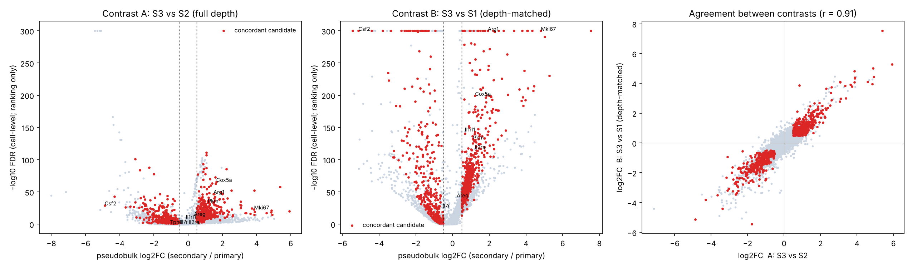

# Phase 6 — exploratory differential expression in ILC2s · GSE295590

> **Exploratory.** Each condition is represented by library-level data with an unknown mouse structure (D-004). Cell-level p-values are pseudoreplicated and used **only to rank genes**. Evidence comes from agreement between two contrasts that share no primary cells, bootstrap stability, and (Phase 10) independent datasets. Claim level: **A — recall-associated state**.

- Contrasts — A: 6,622 vs 221 ILC2s; B: 6,622 vs 8,245 ILC2s
- Candidate rule: FDR < 0.05 in both, |pseudobulk log2FC| ≥ 0.5 in both, same sign, detected in ≥ 10% of the higher group, not contamination-sensitive.
- **Concordant candidates: 883** (498 up, 385 down in secondary).
- Genome-wide agreement of effect sizes between A and B: r = **0.91**.
- Bootstrap sign stability of candidates (200 resamples): median **1.00**.
- Non-cycling stratum (proliferation score ≤ 0.0): **64%** of candidates remain concordant (same sign, FDR < 0.05 in both) — the signal is not explained by proliferating cells alone.

## Genes reported in the source study
| gene | pb_log2fc_A | fdr_A | pb_log2fc_B | fdr_B | candidate | contamination_sensitive |
|---|---|---|---|---|---|---|
| Arg1 | 1.48 | 1.27e-47 | 1.92 | 0 | ✓ |  |
| Cox5a | 1.64 | 2.45e-66 | 1.23 | 5.82e-200 | ✓ |  |
| Pkm | 1.14 | 4.8e-34 | 1.11 | 5.08e-132 | ✓ |  |
| Areg | 0.338 | 1.9e-13 | 0.228 | 3.01e-42 |  |  |
| Il2ra | 0.03 | 0.626 | 1.21 | 2.62e-117 |  |  |
| Il1rl1 | -0.135 | 3.43e-09 | 0.669 | 1.54e-144 |  |  |
| Mki67 | 3.86 | 1.96e-23 | 4.81 | 0 | ✓ |  |
| Il7r | -0.437 | 0.236 | -0.547 | 2.11e-26 |  |  |
| Csf2 | -4.88 | 7.15e-30 | -5.13 | 0 | ✓ |  |

## Top concordant genes — up in secondary
|  | pb_log2fc_A | pb_log2fc_B | fdr_A | fdr_B | bootstrap_stability |
|---|---|---|---|---|---|
| Il1r2 | 5.38 | 7.53 | 2.38e-58 | 0 | 1 |
| Tff1 | 5.92 | 5.27 | 5.64e-21 | 4.32e-231 | 1 |
| Ube2c | 4.87 | 5.02 | 7.95e-22 | 1.9e-291 | 1 |
| Nusap1 | 4.91 | 4.44 | 2.02e-15 | 5.3e-215 | 1 |
| Cdk1 | 4.59 | 4.1 | 5.34e-18 | 2.17e-211 | 1 |
| Cdca3 | 4.84 | 3.96 | 5.15e-19 | 2.07e-193 | 1 |
| Birc5 | 3.88 | 4.33 | 8.01e-20 | 0 | 1 |
| Cenpf | 3.87 | 4.39 | 3.04e-15 | 1.42e-207 | 1 |
| Fabp5 | 3.87 | 4.07 | 7.36e-53 | 0 | 1 |
| Mki67 | 3.86 | 4.81 | 1.96e-23 | 0 | 1 |
| Pclaf | 3.71 | 3.79 | 4.45e-25 | 0 | 1 |
| Cdca8 | 3.64 | 3.91 | 4.65e-17 | 8.21e-239 | 1 |
| Ccnb2 | 3.35 | 3.84 | 6.33e-18 | 1.38e-197 | 1 |
| Top2a | 3.07 | 4.09 | 1.2e-25 | 0 | 1 |
| Cxcl3 | 3.07 | 4.09 | 8.2e-36 | 0 | 1 |
| Rrm2 | 3.39 | 3 | 2.9e-18 | 2.22e-201 | 1 |
| Tyms | 3.1 | 2.98 | 1.66e-29 | 3.27e-264 | 1 |
| Stmn1 | 3.06 | 2.78 | 1.15e-30 | 0 | 1 |
| Clspn | 2.61 | 2.89 | 6.2e-15 | 5.18e-146 | 1 |
| Tpx2 | 2.6 | 3.75 | 1e-12 | 2.89e-192 | 1 |
| Cks1b | 2.56 | 3.35 | 2.34e-23 | 0 | 1 |
| Ctla4 | 2.52 | 2.51 | 4.64e-53 | 0 | 1 |
| Gmnn | 2.38 | 2.35 | 1.2e-19 | 4.52e-178 | 1 |
| Spc24 | 2.32 | 3.64 | 1.62e-15 | 4.83e-210 | 1 |
| Mthfd2 | 2.27 | 2.33 | 8.34e-22 | 1.55e-158 | 1 |
| Cst7 | 2.31 | 2.23 | 1.75e-40 | 1.86e-224 | 1 |
| Dut | 2.11 | 2.21 | 1e-34 | 9.15e-303 | 1 |
| H2-Eb1 | 2.1 | 2.51 | 2.95e-18 | 2.26e-177 | 1 |
| Tnfrsf4 | 2.04 | 2.15 | 2.56e-18 | 1.3e-173 | 1 |
| Hmgb2 | 2.05 | 2.02 | 7.87e-40 | 2.48e-272 | 1 |

## Top concordant genes — down in secondary
|  | pb_log2fc_A | pb_log2fc_B | fdr_A | fdr_B | bootstrap_stability |
|---|---|---|---|---|---|
| Csf2 | -4.88 | -5.13 | 7.15e-30 | 0 | 1 |
| Klf2 | -4.31 | -3.81 | 9.08e-44 | 0 | 1 |
| Plaur | -3.66 | -3.51 | 6.94e-27 | 2.59e-235 | 1 |
| Spry2 | -3.38 | -4.41 | 9.61e-28 | 0 | 1 |
| Lpcat2 | -3.1 | -3.18 | 1.61e-34 | 2e-104 | 1 |
| Tnfrsf9 | -3.02 | -3.08 | 2.16e-11 | 1.74e-184 | 1 |
| S1pr1 | -2.82 | -3.25 | 1.64e-10 | 1.38e-104 | 1 |
| Klf3 | -2.71 | -2.72 | 3.25e-27 | 4.56e-107 | 1 |
| Isg15 | -2.65 | -3.47 | 0.00367 | 8.71e-224 | 1 |
| Tle4 | -2.64 | -2.77 | 2.42e-33 | 2.19e-130 | 1 |
| Camk2n1 | -2.63 | -2.61 | 5.52e-22 | 2.45e-150 | 1 |
| Uba52 | -2.59 | -3.35 | 2.31e-43 | 0 | 1 |
| Bcl2l11 | -2.57 | -2.88 | 2.04e-32 | 1.09e-183 | 1 |
| Bloc1s1 | -2.54 | -2.94 | 3.78e-24 | 7.69e-100 | 1 |
| Gm11808 | -2.53 | -2.62 | 6.07e-39 | 0 | 1 |
| Snhg9 | -2.52 | -3.21 | 2.34e-29 | 1.91e-114 | 1 |
| Rnaset2a | -2.78 | -2.46 | 2.57e-41 | 9.53e-127 | 1 |
| Rnaset2b | -2.47 | -2.39 | 1.73e-29 | 3.31e-101 | 1 |
| Fcer1g | -2.44 | -2.34 | 1.03e-10 | 1.1e-102 | 1 |
| Calca | -2.59 | -2.33 | 6.15e-08 | 0 | 1 |

Full tables: `results/differential_expression/`.

## Figures

