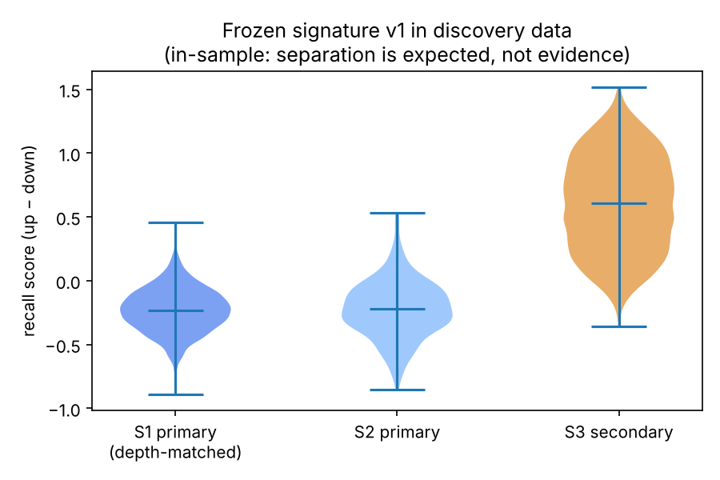

# Phase 7 — pathways and frozen discovery signature · GSE295590

## Hallmark — concordant pathways (18 of 44 tested)
| Term | NES_A | fdr_A | NES_B | fdr_B | direction |
|---|---|---|---|---|---|
| HALLMARK_OXIDATIVE_PHOSPHORYLATION | 2.52 | 0 | 2 | 0 | up_in_secondary |
| HALLMARK_MYC_TARGETS_V1 | 2.5 | 0 | 2.38 | 0 | up_in_secondary |
| HALLMARK_E2F_TARGETS | 2.44 | 0 | 2.68 | 0 | up_in_secondary |
| HALLMARK_DNA_REPAIR | 1.89 | 0.000171 | 1.89 | 0.000125 | up_in_secondary |
| HALLMARK_MTORC1_SIGNALING | 1.84 | 0.000411 | 1.62 | 0.019 | up_in_secondary |
| HALLMARK_G2M_CHECKPOINT | 1.81 | 0.000914 | 2.34 | 0 | up_in_secondary |
| HALLMARK_FATTY_ACID_METABOLISM | 1.8 | 0.000882 | 1.48 | 0.0441 | up_in_secondary |
| HALLMARK_GLYCOLYSIS | 1.78 | 0.000943 | 1.55 | 0.0292 | up_in_secondary |
| HALLMARK_PEROXISOME | 1.47 | 0.0385 | 1.48 | 0.0478 | up_in_secondary |
| HALLMARK_COMPLEMENT | -1.55 | 0.0236 | -1.9 | 0.00269 | down_in_secondary |
| HALLMARK_IL6_JAK_STAT3_SIGNALING | -1.57 | 0.0233 | -2.01 | 0.00157 | down_in_secondary |
| HALLMARK_KRAS_SIGNALING_UP | -1.58 | 0.0258 | -2.03 | 0.0022 | down_in_secondary |
| HALLMARK_TGF_BETA_SIGNALING | -1.59 | 0.0257 | -1.61 | 0.0163 | down_in_secondary |
| HALLMARK_KRAS_SIGNALING_DN | -1.59 | 0.0299 | -2.18 | 0.000734 | down_in_secondary |
| HALLMARK_INFLAMMATORY_RESPONSE | -1.61 | 0.0313 | -2.17 | 0.00055 | down_in_secondary |
| HALLMARK_HYPOXIA | -1.74 | 0.0191 | -2.27 | 0 | down_in_secondary |
| HALLMARK_ESTROGEN_RESPONSE_EARLY | -1.85 | 0.00998 | -1.53 | 0.0296 | down_in_secondary |
| HALLMARK_TNFA_SIGNALING_VIA_NFKB | -3.24 | 0 | -3.45 | 0 | down_in_secondary |

## Reactome — concordant pathways (45 of 434 tested)
| Term | NES_A | fdr_A | NES_B | fdr_B | direction |
|---|---|---|---|---|---|
| REACTOME_NONSENSE_MEDIATED_DECAY_NMD_INDEPENDENT_OF_THE_EXON_JUNCTION_COMPLEX_EJC | 3.06 | 0 | 2.41 | 0 | up_in_secondary |
| REACTOME_NONSENSE_MEDIATED_DECAY_NMD | 3 | 0 | 2.38 | 0 | up_in_secondary |
| REACTOME_EUKARYOTIC_TRANSLATION_INITIATION | 2.98 | 0 | 2.33 | 0 | up_in_secondary |
| REACTOME_TRANSLATION | 2.93 | 0 | 2.33 | 0 | up_in_secondary |
| REACTOME_MAJOR_PATHWAY_OF_RRNA_PROCESSING_IN_THE_NUCLEOLUS_AND_CYTOSOL | 2.72 | 0 | 2.28 | 0 | up_in_secondary |
| REACTOME_ACTIVATION_OF_THE_MRNA_UPON_BINDING_OF_THE_CAP_BINDING_COMPLEX_AND_EIFS_AND_SUBSEQUENT_BINDING_TO_43S | 2.63 | 0 | 2.15 | 7.9e-05 | up_in_secondary |
| REACTOME_MITOCHONDRIAL_TRANSLATION | 2.49 | 0 | 2.26 | 0 | up_in_secondary |
| REACTOME_ANTIGEN_PROCESSING_UB_ATP_INDEPENDENT_PROTEASOMAL_DEGRADATION | 2.3 | 0 | 1.8 | 0.00893 | up_in_secondary |
| REACTOME_RESPIRATORY_ELECTRON_TRANSPORT | 2.26 | 0 | 1.84 | 0.00582 | up_in_secondary |
| REACTOME_CROSS_PRESENTATION_OF_SOLUBLE_EXOGENOUS_ANTIGENS_ENDOSOMES | 2.19 | 0 | 1.86 | 0.00453 | up_in_secondary |
| REACTOME_PROTEASOME_ASSEMBLY | 2.18 | 0 | 1.85 | 0.00461 | up_in_secondary |
| REACTOME_REGULATION_OF_ORNITHINE_DECARBOXYLASE_ODC | 2.17 | 0 | 1.68 | 0.0337 | up_in_secondary |
| REACTOME_DNA_REPLICATION | 2.14 | 0 | 1.94 | 0.00178 | up_in_secondary |
| REACTOME_S_PHASE | 2.12 | 0 | 1.92 | 0.00215 | up_in_secondary |
| REACTOME_G1_S_TRANSITION | 2.1 | 0 | 1.72 | 0.0251 | up_in_secondary |
| REACTOME_CHAPERONIN_MEDIATED_PROTEIN_FOLDING | 2.08 | 0 | 1.82 | 0.00796 | up_in_secondary |
| REACTOME_DNA_REPLICATION_PRE_INITIATION | 2.06 | 4.21e-05 | 1.7 | 0.0269 | up_in_secondary |
| REACTOME_G2_M_CHECKPOINTS | 2.05 | 7.75e-05 | 1.86 | 0.00447 | up_in_secondary |
| REACTOME_METABOLISM_OF_NUCLEOTIDES | 2.04 | 7.45e-05 | 2.2 | 0 | up_in_secondary |
| REACTOME_RESOLUTION_OF_AP_SITES_VIA_THE_MULTIPLE_NUCLEOTIDE_PATCH_REPLACEMENT_PATHWAY | 2.02 | 9.68e-05 | 2.11 | 0.000124 | up_in_secondary |
| REACTOME_CELL_CYCLE_CHECKPOINTS | 2 | 0.000153 | 1.78 | 0.0117 | up_in_secondary |
| REACTOME_MITOTIC_G1_PHASE_AND_G1_S_TRANSITION | 2 | 0.000149 | 1.71 | 0.0256 | up_in_secondary |
| REACTOME_METABOLISM_OF_AMINO_ACIDS_AND_DERIVATIVES | 1.99 | 0.000194 | 1.73 | 0.021 | up_in_secondary |
| REACTOME_MITOCHONDRIAL_PROTEIN_DEGRADATION | 1.99 | 0.000236 | 1.74 | 0.021 | up_in_secondary |
| REACTOME_PCNA_DEPENDENT_LONG_PATCH_BASE_EXCISION_REPAIR | 1.98 | 0.000237 | 2.07 | 0.000183 | up_in_secondary |

## Frozen signature `GSE295590_recall_ILC2_signature_v1.tsv`
- SHA-256: `537d38d957780a607e1632b74b4c7060801b02cf7609ea4260862d70d3bcec1a`
- Phase 6 candidates: 883 → retained in non-cycling ILC2s and bootstrap ≥ 0.95: **499** → top 50 per direction.
- **recall_up (50)**: Il1r2, Tff1, Fabp5, Cxcl3, Ctla4, Mthfd2, Cst7, Dut, H2-Eb1, Tnfrsf4, H2-DMa, Selenoh, H2-Ab1, Dctpp1, Trerf1, H2-Aa, Ttc39c, Batf, Lgals1, Il13, Siva1, Serpinb6a, Cd74, Prdx4, AW112010, Cisd1, Tomm5, Nudcd2, Pgk1, Tpi1, Arg1, Impa2, Glrx, Mrpl12, Mpp6, Vim, Aprt, Ecm1, Cpd, Hint1, Nhp2, Sh3bgrl, Alad, Nudt21, Erg28, Nme1, Cox5a, Gapdh, Npm1, Mrpl51
- **recall_down (50)**: Csf2, Klf2, Plaur, Spry2, Lpcat2, Tnfrsf9, S1pr1, Klf3, Isg15, Tle4, Camk2n1, Uba52, Bcl2l11, Bloc1s1, Gm11808, Snhg9, Rnaset2a, Rnaset2b, Fcer1g, Calca, Zfp36, Gem, Cebpb, Pdcd4, Kmt2d, Klf4, Maff, Susd6, Kit, Fos, Malat1, Sdc4, Rab27b, Ets2, B930036N10Rik, Tcf7, Klf10, Cxcr4, Jag1, H2-Q4, Serpinb9, Rasgrp2, AC149090.1, Socs2, Ifi203, Trim12a, Ccl4, Hexim1, Hes1, Chmp1b

Frozen before any validation-dataset expression values were analysed. Phase 10 tests it in independent datasets; the discovery-data score below is in-sample and is shown only as a sanity check.

## Phase 7 gate
The pipeline gate (signature stable on ≥ 1 compatible dataset) is evaluated in Phase 10. Internal stability is shown by the bootstrap and non-cycling filters above.

## Figures

