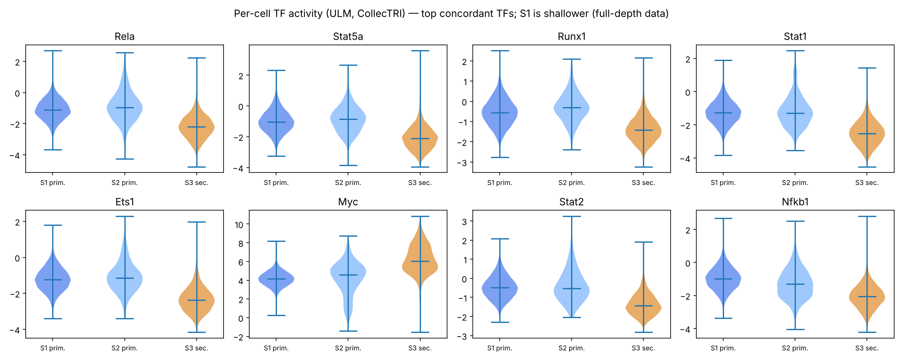

# Phase 8 — transcription-factor and pathway activity · GSE295590

> Activity is inferred from target-gene expression (decoupler ULM on CollecTRI). It is **not** evidence of TF binding or function. Claim level: A/B boundary — supported by expression only.

- TFs scored: 444; concordant in both contrasts (FDR < 0.05, same sign): 17; also target-supported (≥ 5 candidate targets, ≥ 60% direction agreement): **14**.

## PHASE 8 GATE: PASS — every prioritised TF is cross-checked against target-gene support.

## Prioritised TFs — more active in secondary (1)
| tf | score_A | fdr_A | score_B | fdr_B | n_candidate_targets | direction_agreement | tf_gene_log2fc_A | supporting_targets |
|---|---|---|---|---|---|---|---|---|
| Myc | 8.15 | 1.25e-10 | 5.58 | 3.56e-05 | 129 | 0.643 | nan | Cdkn1a, Trp53, Cdkn1b, Actl6a, Prdx3, Ybx1, Tpi1, Cdk4, Nme2, Npm1, Pole3, Nme1 |

## Prioritised TFs — less active in secondary (13)
| tf | score_A | fdr_A | score_B | fdr_B | n_candidate_targets | direction_agreement | tf_gene_log2fc_A | supporting_targets |
|---|---|---|---|---|---|---|---|---|
| Rela | -6.61 | 3.29e-06 | -6.71 | 2.61e-07 | 62 | 0.661 | -0.607 | Jag1, Icam1, Nfkbia, Csf2, Oga, Hes1, Cxcr4, Pparg, Gstp1, Fos, Relb, Klf2 |
| Stat5a | -6.36 | 7.44e-06 | -6.32 | 1.38e-06 | 22 | 0.818 | nan | Fos, Ccnd2, Pim1, Cd69, Il18r1, Npm1, Csf2, Bcl10, Cdkn1a, Socs2, Socs1, Calca |
| Runx1 | -5.81 | 0.000106 | -6.18 | 1.65e-06 | 21 | 0.667 | -0.471 | Fos, Jund, Csf2, H2-T23, Anxa1, Tcf12, Klf4, Kit, Calca, Hes1, Ccnd2, Jun |
| Stat1 | -5.76 | 0.000106 | -7.9 | 6.83e-10 | 29 | 0.828 | -0.638 | Cdkn1a, Irf1, Socs1, Icam1, Jak1, Pparg, Klf4, Jun, H2-T23, Birc2, Cdkn1b, Gls |
| Ets1 | -5.66 | 0.00014 | -5.73 | 1.72e-05 | 23 | 0.783 | -0.516 | Il5, Csf2, Cdkn1a, Cdk11b, Ets1, Cxcr4, Zeb1, B4galt1, Fos, Jun, Mcl1, Junb |
| Stat2 | -5.27 | 0.000898 | -5.06 | 0.00038 | 5 | 1 | nan | Jun, H2-T23, Irf1, Jund, Mcl1 |
| Nfkb1 | -4.86 | 0.0035 | -6.29 | 1.38e-06 | 50 | 0.62 | -0.619 | Icam1, Nfkbia, Cxcr4, H2-T23, Relb, Nfkbid, S1pr1, Yy1, Dusp1, Nr4a1, Hspa5, Sdc4 |
| Creb1 | -4.85 | 0.0035 | -6.23 | 1.52e-06 | 54 | 0.63 | -0.443 | Egr1, Nr4a3, Fos, Gstp1, Hspa5, Cdkn1a, Cebpb, Icam1, Gch1, Stat4, Spry2, Skil |
| Irf1 | -4.84 | 0.0035 | -5.01 | 0.000431 | 23 | 0.696 | -2.22 | Irf1, Irf2, Ccl4, Socs1, H2-T23, Cdkn1a, Mki67, Icam1, Jun, Odc1, Ifngr1, Cdk1 |
| Jund | -4.72 | 0.00512 | -7.12 | 3.85e-08 | 9 | 1 | -1.25 | Jund, Cdkn1a, Nr4a1, Cebpz, Plaur, Cdk4, Junb, Oga, Il5 |
| Foxo3 | -4.86 | 0.0035 | -4.46 | 0.00216 | 24 | 0.667 | nan | Cdkn1b, Bcl2l11, Btg1, Cdkn1a, Birc5, Irs2, Klf6, Cxcr4, Jak1, Klf4, Pnrc1, Tle4 |
| Nfkb2 | -4.65 | 0.00574 | -4.38 | 0.00284 | 9 | 0.778 | -1.03 | H2-T23, Relb, Nfkbia, Hspa5, Hes1, Csf2, Ccnd2 |
| Fos | -4.09 | 0.0338 | -7.07 | 3.85e-08 | 37 | 0.676 | -2.02 | Hspa5, Ccnd2, Cebpb, Cd69, Junb, Jun, Notch2, Csf2, Il5, Smad7, Fosb, H2-T23 |

## TFs named by the independent studies
| tf | source | score_A | fdr_A | score_B | fdr_B | concordant | target_supported |
|---|---|---|---|---|---|---|---|
| Bach2 | GSE172258 | 1.11 | 0.882 | 1.05 | 0.711 |  |  |
| Jund | GSE172258 | -4.72 | 0.00512 | -7.12 | 3.85e-08 | ✓ | ✓ |
| Fosl2 | GSE172258 | -2.07 | 0.624 | -4.51 | 0.00216 |  | ✓ |
| Fhl2 | GSE172258 | -1.15 | 0.866 | -1.87 | 0.446 |  |  |
| Fosb | GSE172258 | -0.0296 | 0.992 | 2.64 | 0.191 |  |  |
| Stat6 | GSE172258 | -1.97 | 0.624 | -3.61 | 0.0211 |  | ✓ |
| Srebf2 | GSE172258 | 1.46 | 0.739 | 1.35 | 0.641 |  |  |
| Batf | GSE149854 | -1.82 | 0.624 | -1.65 | 0.542 |  |  |
| Gata3 | ILC2 identity | -4.11 | 0.0338 | -3.83 | 0.0114 | ✓ |  |
| Rora | ILC2 identity | -0.028 | 0.992 | 1.53 | 0.597 |  |  |

## PROGENy pathway activity
| pathway | score_A | fdr_A | score_B | fdr_B | concordant |
|---|---|---|---|---|---|
| Estrogen | 7.47 | 6.87e-13 | 7.12 | 1.57e-11 | ✓ |
| MAPK | 6.83 | 4.91e-11 | 4.99 | 2.5e-06 | ✓ |
| EGFR | 6.14 | 3.38e-09 | 3.01 | 0.00518 | ✓ |
| PI3K | 5.34 | 2.96e-07 | 5.47 | 2.65e-07 | ✓ |
| WNT | 1.76 | 0.127 | 0.84 | 0.465 |  |
| Trail | -0.373 | 0.709 | -0.0751 | 0.94 |  |
| Androgen | -0.671 | 0.583 | -1.77 | 0.124 |  |
| VEGF | -1.43 | 0.209 | -0.921 | 0.465 |  |
| JAK-STAT | -3.3 | 0.00193 | -4.76 | 5.97e-06 | ✓ |
| TGFb | -4.25 | 5.33e-05 | -3.4 | 0.00166 | ✓ |
| TNFa | -7.55 | 5.72e-13 | -10.5 | 5.31e-24 | ✓ |
| p53 | -7.85 | 9.8e-14 | -6.95 | 3.14e-11 | ✓ |
| NFkB | -12.4 | 1.77e-33 | -13.6 | 2.12e-39 | ✓ |
| Hypoxia | -17.5 | 0 | -13.6 | 2.12e-39 | ✓ |

## Figures

