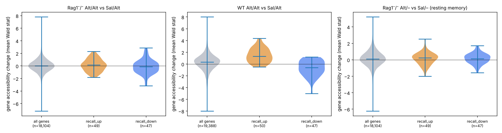

# Phase 9 — epigenomic integration (GSE172258 ATAC-seq)

- Status: **performed** (compatible chromatin data identified in Phase 1).
- **Verdict (pre-registered, D-014): PARTIAL REGULATORY SUPPORT** — `recall_up` genes gain accessibility (one-sided p < 0.05) in 1 of 2 recall comparisons.
- Peaks linked to the nearest RefSeq TSS (mm10) within 50 kb; gene statistic = mean DESeq2 Wald statistic of its peaks; pydeseq2 with default settings.
- Motif enrichment: **not performed** — no genome sequence / motif database in this project (D-014).
- Cross-model caveat: Alternaria allergen memory (Rag1⁻/⁻ and WT) vs *N. brasiliensis* recall in the discovery data — agreement indicates a shared program, not identical biology.

## Signature vs accessibility
| comparison | recall | n | peaks_tested | DA_peaks_FDR5 | up_genes | p_up_gain | down_genes | p_down_loss |
|---|---|---|---|---|---|---|---|---|
| Rag1⁻/⁻ Alt/Alt vs Sal/Alt | True | 3 v 3 | 99813 | 4131 | 49 | 0.353 | 47 | 0.119 |
| WT Alt/Alt vs Sal/Alt | True | 3 v 3 | 136184 | 24735 | 50 | 1.99e-09 | 47 | 2.91e-06 |
| Rag1⁻/⁻ Alt/– vs Sal/– (resting memory) | False | 2 v 3 | 99815 | 1829 | 49 | 0.35 | 47 | 0.657 |

## Signature genes with consistent accessibility in both recall comparisons (|stat| > 2): 1
Il1r2 (up)

## Figures

