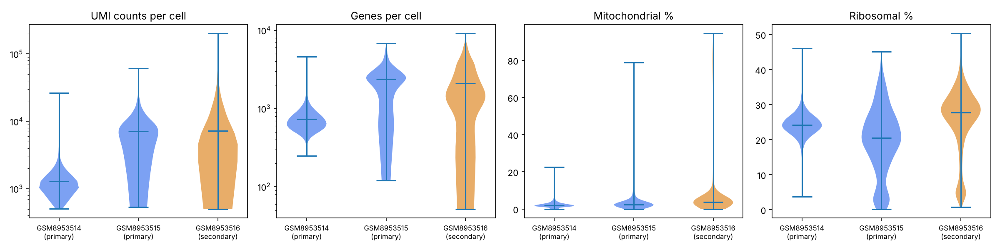
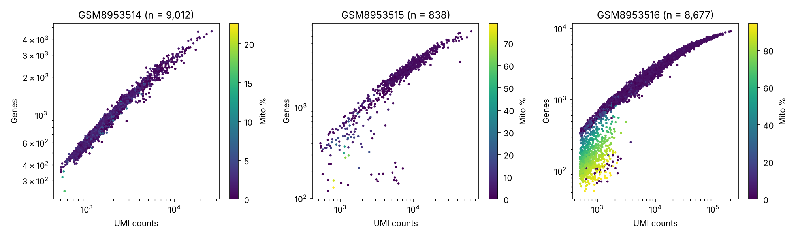

# Phase 3 — single-cell QC · GSE295590

- Mode: **report-only**
- **PHASE 3 GATE: NOT EVALUABLE** — threshold(s) not yet agreed: `min_cells_per_sample`, `max_pct_mito`, `min_genes_per_cell`, `max_genes_per_cell`. No cells were removed.
- Doublet scoring: scrublet, per sample

> Cell counts are not biological sample sizes. These metrics describe libraries; the replicate structure of GSE295590 remains UNRESOLVED (docs/GSE295590_design.md).

## Per-sample metrics
| sample | sample_title | infection_group | n_cells | cells_vs_median | median_total_counts | median_genes | median_pct_mt | p90_pct_mt | pct_cells_mt_gt20 | median_pct_ribo |
|---|---|---|---|---|---|---|---|---|---|---|
| GSM8953514 | Primary-Inf-ILCs_S1 | primary | 9,012 | 1.04 | 1,283.00 | 732.00 | 1.99 | 3.71 | 0.01 | 24.21 |
| GSM8953515 | Primary-Inf-ILCs_S2 | primary | 838 | 0.10 | 7,160.00 | 2,386.50 | 2.30 | 5.84 | 1.43 | 20.52 |
| GSM8953516 | Secondary-Inf-ILCs_S3 | secondary | 8,677 | 1.00 | 7,215.00 | 2,095.00 | 3.70 | 20.47 | 10.07 | 27.73 |

## Flags (descriptive — no cells removed in report-only mode)
Counts/genes outliers: > 5 MAD on log scale, per sample. Mito outliers: > 3 MAD above the sample median. `suggested_max_pct_mt` = median + 3 MAD — a starting point for the threshold discussion, not an agreed value. On narrow mito distributions MAD-based cut-offs are very stringent and can remove metabolically active (OXPHOS-high) cells, so treat them as an upper bound on stringency.

| sample | pct_flag_counts | pct_flag_mito | pct_predicted_doublet | suggested_max_pct_mt |
|---|---|---|---|---|
| GSM8953514 | 2.35 | 8.29 | 0.00 | 3.95 |
| GSM8953515 | 9.79 | 12.77 | 1.19 | 4.35 |
| GSM8953516 | 5.62 | 15.32 | 0.00 | 6.59 |

## Dataset-level observations
- Every library starts at ≈ 500 UMI per cell — the deposited matrices appear to be **already filtered** (e.g. a ≥ 500-UMI cut-off by the authors). Barcodes below that floor cannot be recovered from these files.
- **Sequencing depth differs 5.6×** between libraries (`GSM8953514` median 1,283 UMI vs 7,215). Depth is a technical confounder of any between-sample comparison: normalisation (Phase 4) must account for it, and Phase 11 should include a depth-matched (downsampled) sensitivity analysis.

## Samples to investigate
- `GSM8953514`: scrublet predicted **0 %** doublets in 9,012 cells — its automatic threshold most likely failed (10x libraries of this size typically carry several % doublets). Keep `doublet_score` and assess doublets at cluster level in Phase 5 instead.
- `GSM8953515`: low cell recovery (838 cells, 10% of the median). Investigate library recovery / input; do **not** use it to infer mouse numbers.
- `GSM8953516`: scrublet predicted **0 %** doublets in 8,677 cells — its automatic threshold most likely failed (10x libraries of this size typically carry several % doublets). Keep `doublet_score` and assess doublets at cluster level in Phase 5 instead.
- `GSM8953516`: elevated mitochondrial fraction (median 3.70 % vs 2.30 % across samples). Investigate before excluding.
- `GSM8953516`: 10.1 % of cells have > 20 % mitochondrial reads — a distinct high-mito / low-complexity tail typical of damaged cells. Inspect `qc_counts_vs_genes.png`.

## Figures

Full-resolution outputs (git-ignored): `results/qc/`.

## Next step
Agree `phase3_qc` thresholds in `config/parameters.yaml` (log the decision in `docs/decision_log.md`), then re-run `make qc` to apply them and evaluate the gate.
